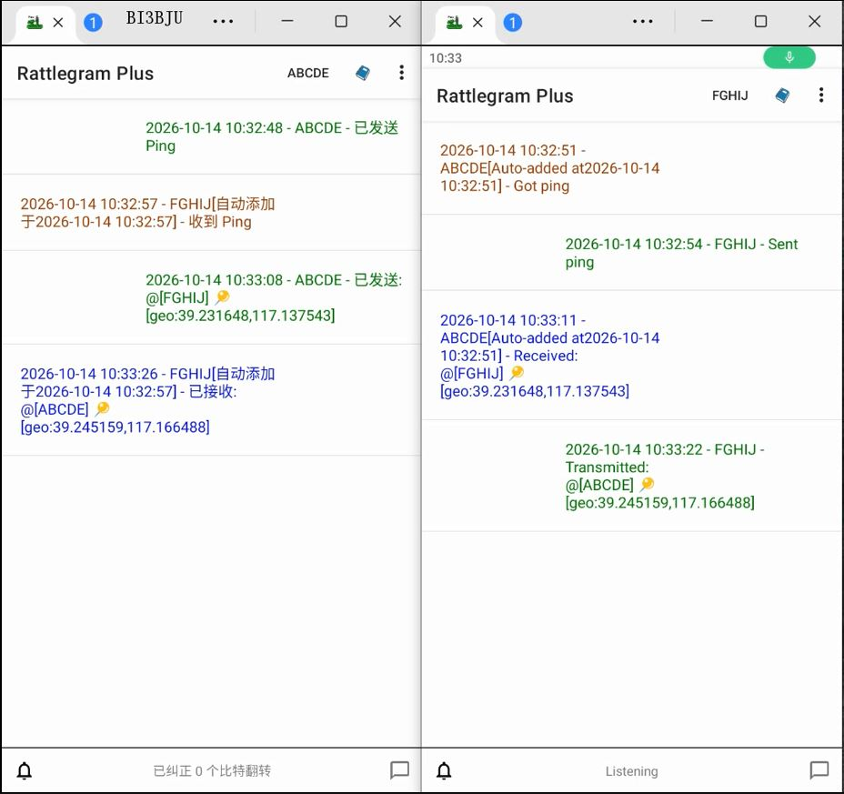

# Rattlegram Plus

[](LICENSE)
[](https://www.java.com/)
[](https://developer.android.com/)
[](https://www.android.com/)
[](https://github.com/BI3BJU/Rattlegram_Plus)
[](https://github.com/BI3BJU/Rattlegram_Plus)

Rattlegram Plus is an Android app that enables short-range text communication via audio modulation/demodulation. It can encode text messages into audible or ultrasonic audio signals and decode these signals from the microphone, enabling point-to-point messaging without Wi‑Fi, Bluetooth, or cellular networks.

This project is a continuation of the original Rattlegram, enhanced with end-to-end encryption, loop beacon, network beacon, and a modern Material Design interface.

## Screenshots



## Features

- 📡 **Audio-based messaging** – Send and receive text through sound (speaker and microphone).
- 🔐 **End-to-end encryption** – Optional AES-256-GCM encryption using transmission modes 17, 18, and 19. The key is derived with PBKDF2-HMAC-SHA256 (600,000 iterations, 32-byte output) from the password and a per-message 8-byte random salt. Each message uses a 12-byte random nonce and a 16-byte GCM tag; the salt is passed as AAD so it is authenticated by the tag. Binary payload layout: `nonce(12) + salt(8) + ciphertext + tag(16)`.
- 📶 **Spectrum analyzer** – Real-time FFT (spectrum) and waterfall (spectrogram) display for signal tuning.
- 🕊️ **Audio beacon (loop beacon)** – Sends one ping (empty message) immediately after start, then repeatedly at the configured interval for local presence detection.
- 🌐 **Network beacon** – Sends and receives network beacons through an APRS-IS server (direct or relay), carrying APRS position, frequency, and tone for wide-area presence detection. Coexists with the audio beacon.
- 🎚️ **Flexible audio settings** – Sample rate, channel selection, audio source, carrier frequency, noise symbols, enhanced header.
- 📨 **Message history** – Persistently stored (max 100 entries), displayed with sent/received styling.
- 👤 **Contacts** – Automatically save received callsigns (except `ANONYMOUS`, max 100), with notes, modify/delete support; tapping a contact fills `@[callsign] ` in the compose box.
- 🔑 **Password management** – Supports 8–256-byte passwords or generates a 32-byte random hex password; the password is kept in memory only and must be re-entered after restart.
- 🔵 **Callsign highlight** – Received messages containing your own callsign anywhere in the body are shown in blue.

## Message Color Hints

| Color | Meaning |
| --- | --- |
| Green | Messages you sent (sent / encrypted sent / own ping) |
| Red | Failure or error messages (highest priority) |
| Blue | Received messages containing your own callsign anywhere in the body (case-sensitive) |
| Default | Any other received message |

## How It Works

The app uses a native C++ library (`librattlegram.so`, sources under `app/src/main/cpp/`) to perform FSK-based modulation and demodulation. Text messages are converted into audio frames, played through the speaker, and received through the microphone. The decoder synchronizes to the incoming signal, extracts the payload, and displays it.

- **Encoder** – Packs the message into structured frames (header + payload), adds error-correction symbols, and generates PCM audio samples.
- **Decoder** – Continuously analyzes microphone input, detects the preamble, synchronizes, and extracts the raw data.
- **Encryption** – When enabled, messages are encrypted with AES-256-GCM before encoding and decrypted after decoding using the same password. The key is derived with PBKDF2-HMAC-SHA256 (600,000 iterations, 32-byte output) from the password and a per-message 8-byte random salt; the salt is also passed as AAD to GCM so it is covered by the tag. Encrypted sending uses transmission modes 17, 18, and 19 with ciphertext payloads of 85 / 128 / 170 bytes, corresponding to plaintext buckets of 49 / 92 / 134 bytes (bucket = payload − 36, where 36 = nonce 12 + salt 8 + tag 16).
- **Decryption** – The receive path reads the 12-byte nonce, 8-byte salt, and ciphertext+tag from the payload according to the mode (85 / 128 / 170 bytes), derives the key, and verifies the GCM tag. A tag mismatch (wrong password, tampered salt, corrupted ciphertext) makes decryption fail and no plaintext is displayed. Legacy blobs from the old single-SHA-256 / no-salt implementation are intentionally rejected and are not decrypted.
- **Beacons** – The audio beacon and the network beacon coexist: the audio beacon plays a local ping through the speaker, while the network beacon exchanges APRS-IS packets over the internet.

## Installation

1. Download the latest APK from the [Releases page](https://github.com/BI3BJU/Rattlegram_Plus/releases).
2. Enable **Install from unknown sources** in Android settings.
3. Install and launch the app.
4. Grant microphone and location permissions when prompted.

> ⚠️ This app requires Android 5.0 (API 21) or higher.

## Building from Source

Clone the repository:

```bash
git clone https://github.com/BI3BJU/Rattlegram_Plus.git
cd Rattlegram_Plus
```

1. Open the project in Android Studio (Arctic Fox or later).
2. Build the native library (using CMake).
   - JNI source code is located under `app/src/main/cpp/`.
   - Make sure NDK and CMake are installed via SDK Manager.
3. Build and run the app on a device or emulator.

## Usage Guide

### 🗣️ Sending Messages

1. Tap the compose button (📝) in the bottom-right corner.
2. Enter text:
   - **Plain**: up to 170 bytes;
   - **Encrypted**: up to 134 plaintext bytes. Encryption uses transmission modes 17, 18, and 19 with plaintext buckets of 49 / 92 / 134 bytes, producing ciphertext payloads of 85 / 128 / 170 bytes (bucket + 36 bytes of nonce/salt/tag overhead).
3. Optionally check **Encrypt** (requires setting a password in the menu).
4. Tap **Send** – the audio will play, and the message will appear as "Sent".

### 📶 Spectrum Analyzer

- Select **Show spectrum** from the menu.
- A dialog appears showing real-time FFT (spectrum) and waterfall (spectrogram).
- Use it to fine-tune the carrier frequency or check signal quality.

### 🔐 Setting a Password

- Open menu → **Password**.
- Enter a password (8–256 bytes) or tap **Generate** to create a 32-byte random hex string.
- Once set, outgoing messages can be encrypted using transmission modes 17, 18, and 19; received encrypted messages are decrypted automatically. The key is derived per message with PBKDF2-HMAC-SHA256 (600,000 iterations) and a random 8-byte salt, so the same password produces different keys for different messages.
- The password is kept in memory only and must be re-entered after the app restarts.
- Clear the password field and confirm to disable encryption.

### 🕊️ Audio Beacon (Loop Beacon)

- Tap the beacon button at the bottom – the app sends one empty message immediately, then repeatedly at the configured interval.
- Tap again to stop.
- The beacon button is shown in green while running.

### 🌐 Network Beacon

- Long-press the beacon button to open **Beacon Configuration**.
- Enable **Send network beacon** and choose **Direct** or **Relay**; enter frequency, tone, position (APRS lat/lon), and send interval.
- Enable **Receive network beacon** to receive network beacons through an APRS-IS server, filtered by receive radius and time window.
- The network beacon coexists with the audio beacon: the audio beacon plays locally, while the network beacon is exchanged over the internet.

### 👤 Contacts

- Open menu → **Contacts**.
- Any received callsign (except `ANONYMOUS` and blank callsigns) is automatically added with note "Auto-added at …", up to 100 contacts.
- Long-press a list item to highlight it, then **Modify** or **Delete**.
- Tapping a contact auto-fills `@[callsign] ` in the compose box.
- Received messages containing your own callsign anywhere in the body are highlighted in blue.

## Permissions

| Permission | Purpose |
| --- | --- |
| `RECORD_AUDIO` | Microphone access (required). |
| `ACCESS_FINE_LOCATION` | Precise GPS location for network beacon position. |
| `ACCESS_COARSE_LOCATION` | Approximate network location for network beacon position (requested together with fine). |

## Configuration Options (Menu)

| Option | Description |
| --- | --- |
| Output / recording sample rate | 8, 16, 32, 44.1, 48 kHz |
| Channel selection | Default / left / right / sum / analytic signal |
| Audio source | Default, microphone, camcorder, voice recognition, unprocessed (requires API 24+) |
| Carrier frequency | About 1000–3000 Hz in normal mode with 50 Hz steps; analytic signal mode supports -3000–3000 Hz |
| Noise symbols | Add extra FEC symbols (0–22) |
| Enhanced header | Use a longer preamble for better synchronization |
| Show spectrum | Open real-time spectrum/spectrogram |
| Password | Set, clear, or generate an encryption password (memory only) |
| Contacts | View, add, modify, delete contacts |
| Delete messages | Clear history |
| Force exit | Fully exit the app |

## Libraries and Dependencies

- **AndroidX** – Modern UI components and compatibility.
- **Native C++ library** – Custom FSK modem, sources under `app/src/main/cpp/`.
- **No external GMS / Play Services** – Location uses only Android's built-in `LocationManager`.
- **No external crypto libraries** – Encryption uses the platform's `javax.crypto` (AES-GCM) and `java.security` (PBKDF2-HMAC-SHA256, `SecureRandom`).

## Contributing

Contributions are welcome! Please open an issue or submit a pull request.

- Use the GitHub issue tracker to report bugs and feature requests.
- Follow the code style of the existing source code.

## License

This project is licensed under the 0BSD License – see the [LICENSE](LICENSE) file for details.

## Acknowledgments

- Original Rattlegram developed by Ahmet Inan <inan@aicodix.de>.
- Rattlegram Plus maintained by BI3BJU <guerilla1949@gmail.com>.

## Disclaimer

This app is provided "as is" for experimental and educational purposes. The author is not responsible for any misuse or damage caused by this software.